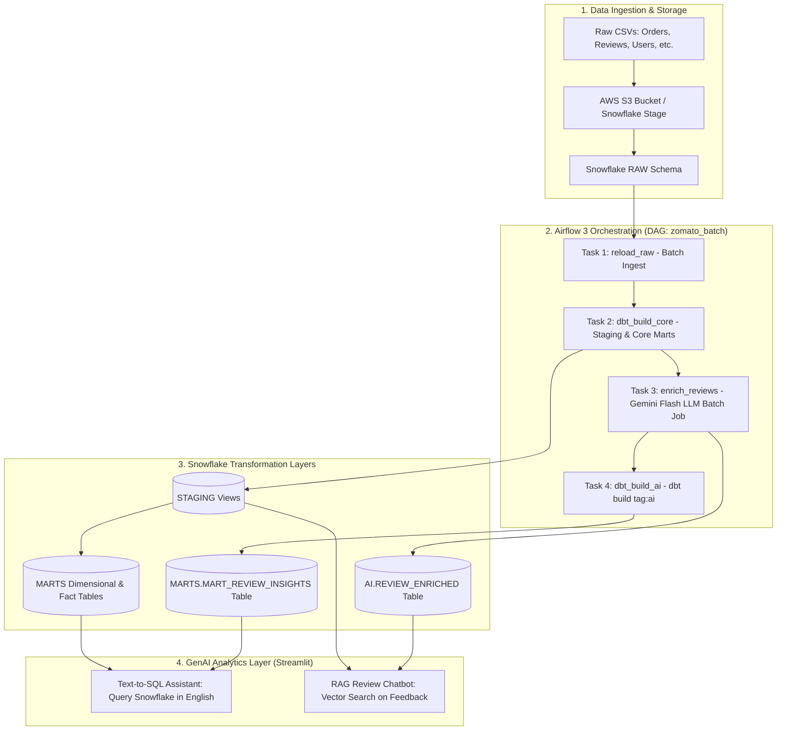

# 🚀 Zomato Modern Data & AI Analytics Platform

[](https://www.snowflake.com/)
[](https://www.getdbt.com/)
[](https://airflow.apache.org/)
[](https://ai.google.dev/)
[](https://www.docker.com/)
[](https://streamlit.io/)

An end-to-end modern enterprise data engineering and GenAI platform built on transactional food delivery data. The platform automates batch ingestion from cloud storage to Snowflake, orchestrates multi-tiered dimensional warehouse modeling in dbt via Apache Airflow 3, enriches customer reviews using Google Gemini LLMs, and delivers interactive self-service analytics through Streamlit.

---

## 📌 Architecture Overview



---

## ✨ Key Features

- **Decoupled Airflow 3.x Orchestration:** Containerized Airflow with separated `api-server`, standalone `dag-processor`, and an isolated Python virtual environment for dbt execution.
- **Dimensional Data Modeling with dbt:**
  - **Staging Layer:** Lightly cleansed views (`stg_orders`, `stg_reviews`, `stg_restaurants`, `stg_users`, `stg_food`, `stg_menu`).
  - **Core Marts:** Star-schema fact tables (`fct_orders`, `fact_order_items`), dimension tables (`dim_customer`, `dim_restaurants`, `dim_food`, `dim_date`), and domain marts (`mart_daily_city_revenue`, `mart_delivery_sla`, `mart_restaurant_performance`).
  - **AI Insights Mart:** `mart_review_insights` joining customer review dimensions with LLM-extracted sentiment and defect categories.
- **LLMOps Review Enrichment:**
  - Automated sentiment scoring, topic tagging (`food quality`, `delivery`, `pricing`, `service`, `packaging`), and root-cause extraction via **Google Gemini Flash**.
  - Idempotent incremental loading into Snowflake `AI` schema.
- **Self-Service GenAI Applications:**
  - **Text-to-SQL Assistant (`ai/text_to_sql.py`):** Translates natural language into Snowflake SQL queries with built-in safety guardrails against destructive DDL/DML.
  - **RAG Review Chatbot (`ai/rag_chat.py`):** Vector search powered by `gemini-embedding-001` with local Parquet caching and grounded context generation.

---

## 📂 Repository Structure

```
.
├── airflow/
│   ├── dags/
│   │   └── zomato_batch.py         # Airflow 3 DAG orchestrating ELT + AI steps
│   ├── docker-compose.yaml         # Airflow 3 + Postgres multi-container setup
│   ├── Dockerfile                  # Airflow image with dbt venv, Snowflake & Gemini
│   └── .env.example                # Airflow credentials template
├── zomato/                         # dbt Project
│   ├── dbt_project.yml
│   ├── profiles.example.yml        # dbt Snowflake profile template
│   └── models/
│       ├── staging/                # Staging views & source YAMLs
│       └── marts/                  # Fact, Dimension & AI Mart tables
├── ai/                             # GenAI & Streamlit Applications
│   ├── enrich_reviews.py           # Gemini batch review classification
│   ├── text_to_sql.py              # Streamlit Text-to-SQL application
│   ├── rag_chat.py                 # Streamlit RAG review search application
│   └── .env.example                # AI apps environment template
└── .gitignore                      # Excludes large CSVs, logs, and credentials
```

---

## ⚡ Quickstart & Setup Guide

### 1. Prerequisites
- [Docker Desktop](https://www.docker.com/) installed and running
- [Python 3.10+](https://www.python.org/)
- Snowflake account with permissions to create databases and warehouses
- Google Gemini API Key from [Google AI Studio](https://aistudio.google.com/)

### 2. Configure Environment Variables
Copy and fill in the example configuration files:
```bash
# Airflow config
cp airflow/.env.example airflow/.env

# AI Apps config
cp ai/.env.example ai/.env

# dbt profile config
cp zomato/profiles.example.yml zomato/profiles.yml
```

### 3. Launch Airflow Pipeline
```bash
cd airflow
docker compose up -d --build
```
- Open Airflow UI: **http://localhost:8080** (Username: `admin`, Password: `admin`)
- Unpause and trigger the `zomato_batch` DAG.

### 4. Run dbt Standalone (Optional)
```bash
cd zomato
dbt run --profiles-dir .
dbt test --profiles-dir .
```

### 5. Launch the Streamlit Applications
```bash
cd ai

# 1. Text-to-SQL Analytics Assistant
streamlit run text_to_sql.py

# 2. RAG Review Semantic Search Chatbot
streamlit run rag_chat.py
```

---

## 🛡️ Security & Privacy
- **No Credentials in Repo:** Sensitive environment variables, passwords, and API keys are strictly excluded via `.gitignore`.
- **Large Files:** Multi-gigabyte raw data files (`*.csv`, `*.parquet`) are ignored to comply with GitHub file size constraints.
- **SQL Safety:** The Text-to-SQL engine strictly disallows DDL/DML statements (`DROP`, `DELETE`, `UPDATE`, `INSERT`, etc.) and runs under read-only warehouse roles.
